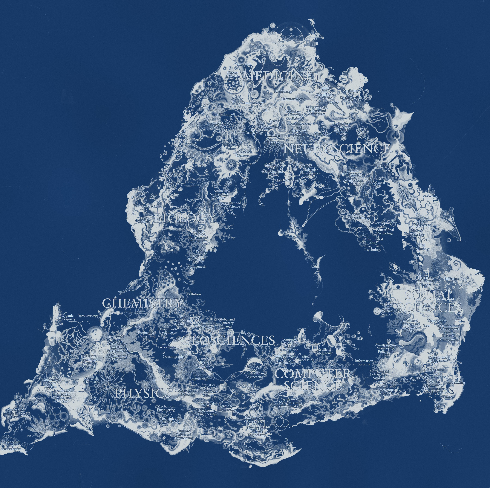

# {.cyan-part background-color="#183a68"}

```{=html}
<div class="cyan-stage title-stage">
  <div class="ground"></div>
  
  <div class="t-kicker" style="top:316px">PSA 2026</div>
  <h1 class="t-title" style="top:358px">From tracing<br>model transfer<br>to predicting it</h1>
  <div class="t-by" style="top:612px">Chiara Lisciandra &amp; Maximilian Noichl</div>
  <div class="t-aff" style="top:680px">HHU Düsseldorf · Utrecht University</div>
</div>
```


# Introduction
* **Chiara Lisciandra**
* ...
* **Max Noichl**
* ...
* *Thank you, INEM!*


 
# {.cyan-part background-color="#183a68"}

```{=html}
<div class="cyan-stage title-stage plan-stage">
  <div class="ground"></div>
  
  <div class="t-kicker" style="top:352px">The plan</div>
  <ol class="plan-list" style="top:400px">
    <li class="fragment"><span class="num">I</span><span class="txt">Model transfer</span></li>
    <li class="fragment"><span class="num">II</span><span class="txt">Modeling gaps in the literature</span></li>
    <li class="fragment"><span class="num">III</span><span class="txt">Predicting model transfer?</span></li>
  </ol>
</div>
```


# Model transfer

* **Model transfer:** applying a model built from one domain in another one.
* A key component of scientific creativity, esp. around economics.
  * Game theory to evolutionary biology, econophysics, TKTK ...some more/better econ examples...
* **Modeling science** to predict and prescribe:
  * Gap maps, literature based discovery, knowledge graphs, ...

::: aside
@knuuttilaLoettgers2016 @knuuttilaLoettgers2023 @boumansHerfeld2022 @herfeldDoehne2025 @noichl2023 @noichl2021 @wang2023
:::


# {.cyan-part background-color="#183a68"}

```{=html}
<div class="cyan-stage">
  <div class="ground"></div>
  
  <div class="kicker">Part I</div>
  <div class="part-title">Gaps in the literature</div>
</div>
```


# AI-assisted literature review

* Keyword-based search in OpenAlex (6k hits) 
* Pare down with Astra 6.1 to 2k papers matching our criteria.
* Add papers with at least 3 citations to or from the sample & filter again.
* Final sample: 2,501 papers. [Pipeline](#){.opens-modal data-modal-type="image" data-modal-url="images/litreview_flow.svg" data-modal-navblock="true"}
* Annotate for normativity and transparency. [Prompts](#){.opens-modal data-modal-type="iframe" data-modal-url="images/litreview_prompts.html" data-modal-navblock="true"}


# Results of the literature review

* Approaches to science-prediction, mapped by transparency and normativity. [Map](#){.opens-modal data-modal-type="iframe" data-modal-url="images/litreview_map.html" data-modal-navblock="true"}
* Gap maps and (AI-based) network models are gaining popularity fast. [Over time](#){.opens-modal data-modal-type="image" data-modal-url="images/litreview_timeline.png" data-modal-navblock="true"}
* Opacity has been shifting... [Opacity](#){.opens-modal data-modal-type="image" data-modal-url="images/litreview_opacity_share.png" data-modal-navblock="true"}
* Normativity has been on the rise! [Normativity](#){.opens-modal data-modal-type="image" data-modal-url="images/litreview_norm_share.png" data-modal-navblock="true"}

<!-- Parked slides: add .parked to a slide's heading to grey it out and mark it as not in the talk. -->

# Network structure and scientific discovery {.dense .parked}

* **Connect disparate literatures:** combining existing knowledge can reveal previously unknown relationships.
* **Literature-based discovery:** connect A and C through their shared relationship with B.
* **The mRNA example:**
  * **A → B:** an mRNA vaccine causes inflammatory reactions that prevent clinical use.
  * **C suppresses B:** another group finds mRNA modifications that suppress those reactions.
  * **Connect A + C:** modify the vaccine accordingly.
* This connection helped enable mRNA vaccines later used against COVID-19.

::: aside
Karikó (2023)
:::

# Identifying gaps in scientific literature {.parked}

| Approach | Representation | Data | Gaps |
|:---|:---|:---|:---|
| **Networks** | Bibliometric networks | Citations, references, collaborations | Missing or weak connections; potential future links |
| **Networks** | Semantic networks | Topics, embeddings, extracted concepts | Semantically related but weakly connected areas |
| **Networks** | Knowledge graphs | Concepts and substantive relationships | Missing concept or claim relationships; link prediction |
| **Maps** | Evidence maps / matrices | Publications coded by predefined categories | Empty or insufficiently populated cells |
| **LLMs** | Literature represented in model parameters | Publications, abstracts, descriptions of findings | New ideas or hypotheses from recombining existing knowledge |

::: {.table-note}
**Network approaches:** identify what is not connected within a reconstructed literature.
:::

::: aside
@saranWhite2018 @wang2023
:::


# {.cyan-part background-color="#183a68"}

```{=html}
<div class="cyan-stage">
  <div class="ground"></div>
  
  <div class="kicker">Part II</div>
  <div class="part-title">Three cases</div>
</div>
```


# Networks + LLMs for classification {.dense}

* **Thoma et al.:** mapping behavioral reinforcement learning research.
* **Motivation:** literature growth risks duplicated efforts and disconnected research communities.
* **Representation:** cluster articles by authors, cited references, and LLM-based similarity of titles and abstracts.
* **Application:** identify communities with overlapping interests but limited exchange.
  * Similar topics + references → opportunities for new collaborations.
  * High semantic similarity + low reference similarity → opportunities to integrate disconnected literatures.
* **Model transfer:** could this have predicted collaboration between psychology and behavioral economics before it began?

::: aside
@thoma2025, forthcoming.
:::

::: notes
Thoma et al., Mapping the landscape of behavioral reinforcement learning research (forthcoming).

Motivation

“With ever more academic articles being published each year [1–3], maintaining a comprehensive overview of a research field is becoming increasingly challenging. Overlooking relevant new work may result in duplicate efforts and inefficient resource allocation, while neglecting previous work may lead to an increasingly fragmented and siloed research landscape with diminished innovative potential.”

Representation
Articles form research clusters using 1) bibliometric data (co-occurrence of authors and references) to measure  similarities in authors and cited references, and 2) LLMs applied to title and abstracts to measure content similarity

Application
Map behavioral reinforcement learning and identify research communities with overlapping interests but limited exchange. “Examining the connections between research countries [clusters] across the landscape serves two goals. On the one hand, it documents the status quo of scientific exchange. On the other hand, it can help to identify promising areas for further advancing scientific exchange (e.g., expanding collaboration networks or integrating knowledge bases). To this end, we examined similarity profiles between research countries; that is, how pairs of countries compare on each of the three similarity spaces (i.e., authors, references, and semantic content)

First, consider the scenario where multiple groups of researchers investigate similar topics and refer to similar references: In this case, there may be a shared research interest, and fostering new collaborations beyond existing author networks may lead to more efficient resource allocation and avoid redundant efforts.

A second pathway to identifying promising areas for scientific exchange addresses the risk of disconnected lines of literature. When two research countries exhibit high semantic similarity but low reference similarity, the scientific community may benefit from integrating the literature to establish a more comprehensive knowledge basis.”

Model transfer: could cases of collaborations among research groups (e.g. “second wave” of collaboration between Psychology + Behavioral Economics) have been predicted by looking at the networks as in the study above, before they even started engaging with each other?
:::

# Knowledge graphs

* **Garg and Fetzer:** *Causal Claims in Economics*.
* **Representation:** each paper becomes an evidence-annotated claim graph.
  * **Nodes:** standardized economic concepts.
  * **Directed edges:** claimed relationships.
  * **Annotations:** the evidentiary basis of each relationship.
* **Application:** reconstruct the credibility revolution; relate causal evidence, novelty, and argumentative structure to publication and citations.
* **Model transfer:** can claim graphs distinguish a transferred explanatory structure from a new combination of topics?

::: aside
@gargFetzer2025, February 2026 revision.
:::

::: notes
Garg and Fetzer, Causal Claims in Economics, February 2026 revision

Representation
Each paper is an evidence-annotated claim graph.
Nodes: standardized economic concepts
Directed edges: claimed relationships
Annotations: the evidentiary basis of each relationship

Application
Reconstruct the credibility revolution in economics and examine how causal evidence, novelty, and argumentative structure relate to publication and citations.
Model transfer
Could claim graphs distinguish the transfer of an explanatory structure from a new combination of topics?
:::

# Knowledge graphs + link prediction

* **Gu and Krenn:** forecasting high-impact research topics.
* **Representation:** an evolving knowledge graph.
  * **Nodes:** concepts extracted from titles and abstracts.
  * **Edges:** concepts jointly investigated in a paper.
  * Connections carry time and citation information.
* **Application:** learn from historical network evolution to predict which unconnected concept pairs will accumulate citations.
* **Model transfer:** could a model and a new target domain be an unconnected pair whose future connection is predicted to be influential?

::: aside
@guKrenn2025
:::

::: notes
Gu and Krenn, Forecasting high-impact research topics via machine learning on evolving knowledge graphs, 2025
Representation
An evolving knowledge graph combines:
Nodes: concepts extracted from titles and abstracts
Edges: concepts jointly investigated in a paper
Time and citations associated with those connections
Application
Train machine-learning models on historical network evolution to predict which previously unconnected concept pairs will accumulate citations.
Model transfer
Could a model and a new target domain appear as an unconnected concept pair whose future connection is predicted to be influential?
:::


# {.cyan-part background-color="#183a68"}

```{=html}
<div class="cyan-stage">
  <div class="ground"></div>
  
  <div class="kicker">Part III</div>
  <div class="part-title">Predicting model transfer?</div>
</div>
```


# Problems
* Doesn't capture model transfer?
* Long range isn't covered?
* What would it take for this to capture model transfer?
* Representation of formal stuff, math structure, phenomenology.
* Worry: do you capture the tails of the distribution?


# When does a predicted connection amount to model transfer? {.parked}

* A missing connection can indicate a **research opportunity**. Promising model transfer requires more.
* **Template identity:** what makes the transferred model recognizably the same template?
* **Applicability:** why should its structure help address the target problem?
* **Epistemic value:** what would make the application scientifically informative?
* **Can network methods capture these conditions—or mainly identify where to investigate them?**

::: notes
When does a predicted connection amount to model transfer?
Questions for evaluating the relevance of network methods to model transfer

A missing connection can indicate an opportunity for research.
Identifying a promising model transfer requires more:
What makes the transferred model recognizably the same template?
Applicability: Why should its structure help address the target problem?
Epistemic value
What would make the application scientifically informative?
Can network methods capture these conditions,
or primarily identify where to investigate them?
:::

# {.cyan-part background-color="#183a68"}

```{=html}
<div class="cyan-stage title-stage">
  <div class="ground"></div>
  
  <div class="t-kicker" style="top:376px">PSA 2026</div>
  <h1 class="t-title thanks" style="top:404px">Thank you</h1>
  <div class="t-by" style="top:534px">Chiara Lisciandra &amp; Maximilian Noichl</div>
</div>
```


# References {.scrollable}

::: {#refs}
:::
